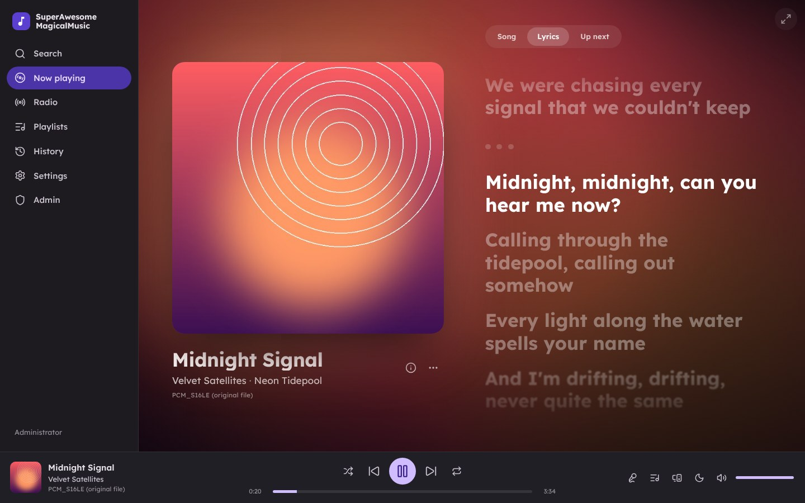
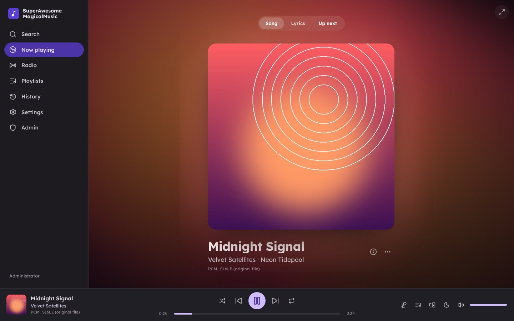
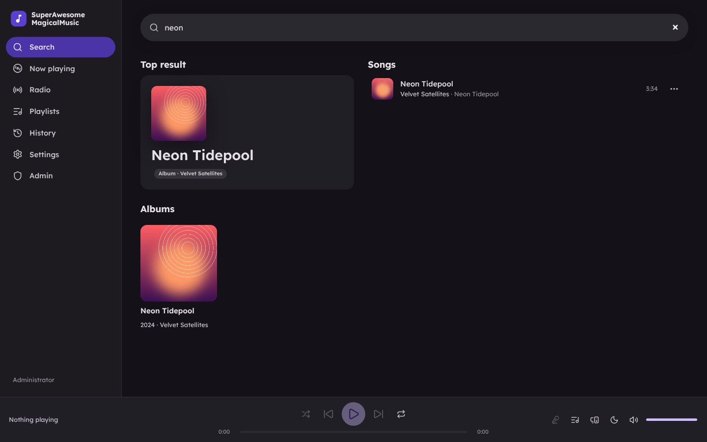
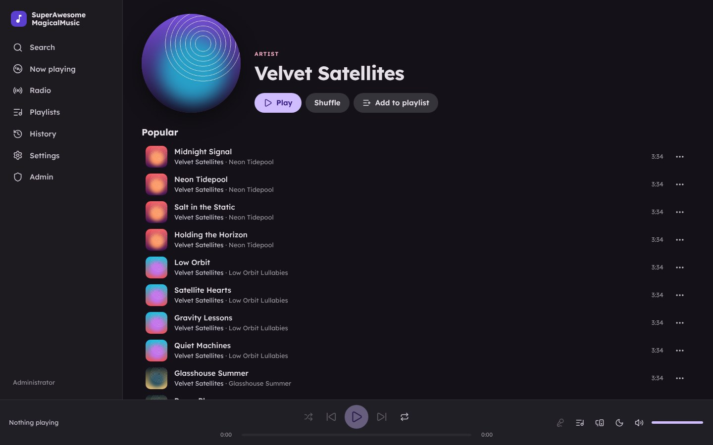
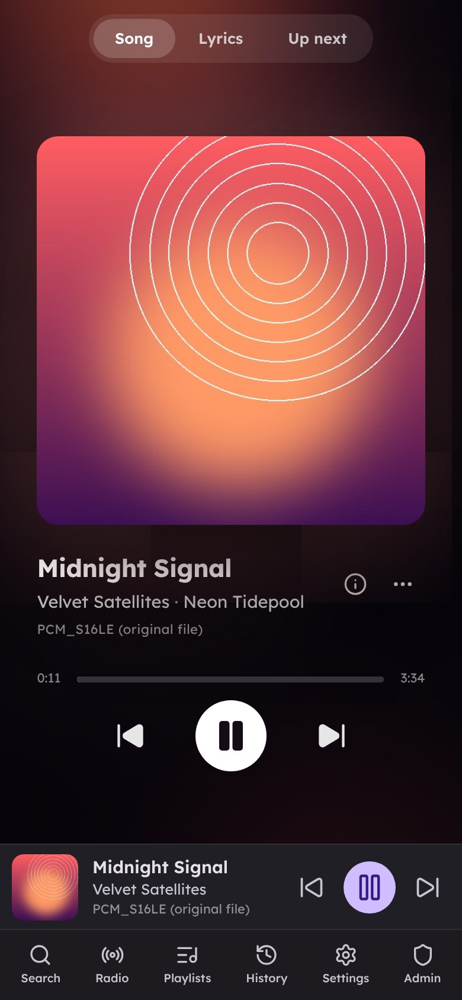
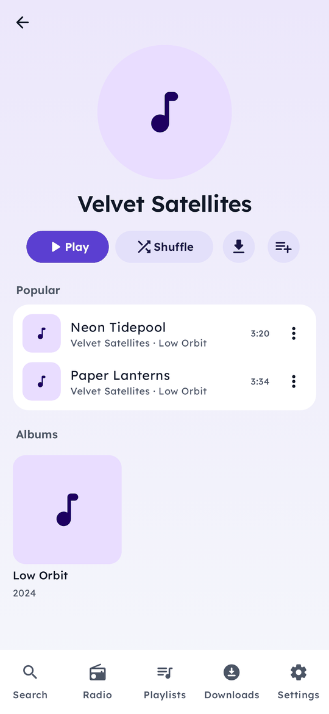
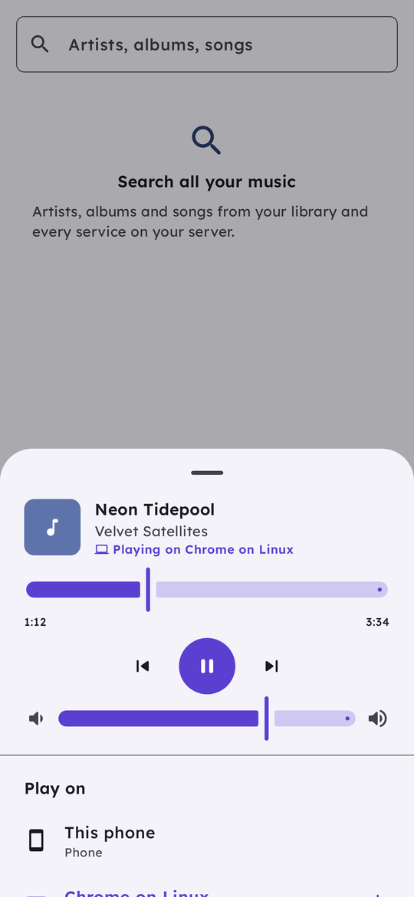
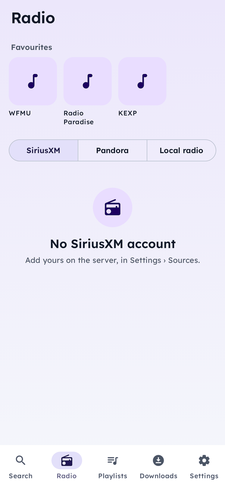
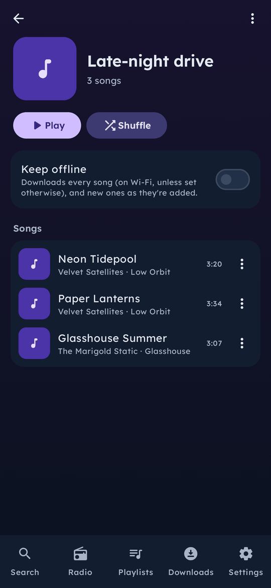

# SuperAwesomeMagicalMusic

Music for self-hosters. It plays from your **Jellyfin** library first and fills the gaps from
**YouTube Music**. It also plays **SiriusXM** live radio and Pandora artist stations,
and songs you hear there can be saved to a playlist. Songs Jellyfin doesn't have get their artist
added to **Lidarr**, queued until your Lidarr server is reachable. Bitrates are set separately for
Wi-Fi, cellular and **satellite** (T-Satellite and other direct-to-cell services). Every song can be
**downloaded** for offline listening, and playlists can stay downloaded and upgrade themselves to
better copies. Playlists belong to your **Nextcloud** account (sign in through the browser, so SSO
such as authentik works) and are kept there. Works in **Android Auto**.

This repository holds:

- **SuperAwesomeMagicalMusic Lite** (`app/`): the standalone Android app described below. It talks
  to every service itself; no server needed.
- **The server** (`server/`, with the **web player** in `web/`): your own streaming service in
  Docker or Podman. Accounts (local, or single sign-on such as Authentik), sources shared by the
  admins or added by each person (SiriusXM and Pandora stations, radio, Jellyfin, YouTube
  Music, Lidarr), playlists and history per person, and a web player for the computer. See [server/README.md](server/README.md):
  `docker run -p 8080:8080 -v samm-data:/data ghcr.io/603madison/superawesomemagicalmusic`.
- **core** (`core/`): the music services (Jellyfin, YouTube Music, SiriusXM, radio, Lidarr,
  lyrics, scrobbling) as plain Kotlin, shared by the app and the server.
- **SuperAwesomeMagicalMusic** (`connect/`): the Android app for the server. Enter the server's
  address and sign in (single sign-on through the browser, or a password); your library, radio and
  playlists are there. Playlists are kept on the phone and changes made offline sync when you're
  back; songs and whole playlists download for offline listening; quality is set separately for
  Wi-Fi, mobile data and satellite; Android Auto, voice search and lyrics. Your devices work
  together (play on one, control it from another, move the music between them), and at home your
  Yamaha MusicCast speakers join them. **Wrapped** sums up your year (top songs, artists and
  stations, when you listen) as a story to tap through, here and in the web player. Installs
  alongside Lite.
- **SuperAwesomeMagicalMusic for Linux** (`desktop/`): a native desktop app for the server (Rust,
  GTK 4 and libadwaita, GStreamer) for Ubuntu 24.04+ and Fedora 40+: search, playlists, history,
  SiriusXM and radio, with media keys and the desktop's media controls, in the same look and
  themes as the web player and the phone app. See
  [desktop/README.md](desktop/README.md).

Kotlin, Jetpack Compose (Material 3), Media3/ExoPlayer, Room, WorkManager. Android 8.0+ (API 26).

## In action

The web player's Now Playing page: the cover's colours fill the window, and the lyrics follow the
song (the line being sung is big and bright; click any line to jump there).



| The Song view (cover and details, no scrolling) | One search box for artists, albums and songs |
| --- | --- |
|  |  |
| **An artist's page** | **The web player on a phone** |
|  |  |

The SuperAwesomeMagicalMusic app (for the server), in the same look as the other apps (Lexend,
rounded cards over a soft gradient, light and dark): an artist's page, controlling the web player
from the phone (devices work together, like Spotify Connect, and MusicCast speakers join them),
favourite stations at the top of Radio, and a playlist in the dark theme.

<p>
  
  
  
  
</p>

The screenshots use a made-up demo library (Velvet Satellites aren't a real band, lol), so the covers
are generated.

## Features

### 1. Sources: Jellyfin first, then YouTube Music, with Lidarr

- **Search** works like a streaming app's: every configured source is asked at once and the
  answers become one set of results, with the likeliest match on top (an artist, an album or a
  song), then songs, artists and albums. The same song, artist or album found on several sources
  is shown once (your library's copy when it has one), and which service it comes from is left
  out. Artists open on their best-known songs, albums and singles; albums on their songs in
  order, taken from your library when it has the whole album. A song's ⋮ menu goes to its artist
  or album.
- **Playback always prefers Jellyfin.** Before a YouTube track plays, it is matched
  against your library (title + artist + duration, ignoring "Remastered", "feat." and similar
  tags), and the Jellyfin copy is used when one exists. A playlist built from YouTube therefore
  switches to your own files once they are in the library.
- **When Jellyfin doesn't have a song**, it streams from YouTube Music, at the best quality that
  fits your bitrate cap.
- **Better networks, better copies:** when you move to a better network (e.g. satellite to Wi-Fi),
  the song playing switches to a better copy where it left off, and songs you replay later are
  picked again for the network you're on.
- **Lidarr:** when you play, download or save a song that isn't in Jellyfin, its artist is looked
  up in your Lidarr library. If the artist is missing, they are found on MusicBrainz through Lidarr
  and added. New artists are monitored and their albums are searched for by default. You can pick
  the root folder and the quality and metadata profiles, or use the server defaults. Artists are
  matched by exact name only, so the wrong artist is never added.
- **Lidarr queue:** Lidarr usually only answers on your home network, so requests are saved and
  sent when the server can be reached: right away if it can, otherwise when the network changes
  (e.g. you get home), every 30 minutes, or when you tap "Send now". Settings › Lidarr lists what's
  waiting.

### SiriusXM

- Sign in with your SiriusXM account and the **Radio** tab lists your channels. Live channels
  play like anything else, including over satellite: the stream's bitrate rounds down to your
  cap for the current network.
- While a channel plays, the app shows the song you're actually hearing (the live edge runs ahead
  of the audio). It appears in the player, the notification and Android Auto.
- **Xtra channels** arrive one track at a time. The app stitches them into one continuous stream:
  shortly before a track ends it tunes the channel again, which hands out the next track, and
  appends it, so playback carries on. It also reports the track being heard to SiriusXM, as
  SiriusXM's own players do.
- **Bookmark** channels with the star; bookmarked channels are listed first in the app and in
  Android Auto.
- **Save** adds that song to a playlist using the usual rules: the Jellyfin copy if your library
  has it. Otherwise the artist goes to Lidarr and the song is saved as a SiriusXM entry, which
  plays from YouTube Music until Lidarr has brought the album into Jellyfin.
- SiriusXM has no public API. The app uses the private API of SiriusXM's web player, following
  the open-source [sxm-player](https://github.com/yob15662/sxm-player) /
  [omarchy-siriusxm](https://github.com/onesastr/omarchy-siriusxm) clients. SiriusXM can change or
  block it at any time. If a channel misbehaves, Settings › SiriusXM › **Copy diagnostics**
  copies what SiriusXM sent, for troubleshooting.

### Pandora artist stations (on SiriusXM)

SiriusXM includes Pandora artist stations: music by and like one artist. Tap **Artist station** on
a song playing on SiriusXM to start one for that artist, or **New station** on the Radio tab to
search for an artist. Stations are saved on the Radio tab and in Android Auto (SiriusXM › Pandora
artist stations). Each track is its own item in the queue, with more fetched as you near the end.
**Thumbs up / down** (in the player and Android Auto) tell the station what you like, as in
SiriusXM's app; thumbs down also skips the song. SiriusXM sends station tracks as single
64 kbps AAC files (HE-AAC, the decoder usually finds), and as far as its web player shows, there's
no higher-quality version to ask for.
SiriusXM's search request isn't documented anywhere public, so artist search is a best guess;
starting a station from a song you're hearing doesn't depend on it.

### Local radio

The Radio tab's **Radio stations** section plays local and internet radio from
[Radio Browser](https://www.radio-browser.info/), a free, open directory. **Find stations near
me** asks once for your approximate (city-level) location, which is sent only to Radio Browser's
search and not stored; stations within 80 km are listed, most listened to first. You can also
search by name, and star favourites. Favourites and the stations found near you are listed in
Android Auto under **Radio**. Next and previous move between stations in the list you played from.

### Android Auto

The app appears as a media source in Android Auto (and to the system, Android Automotive, the
Assistant and Wear OS; other apps can only play, pause and skip). You can browse **Playlists**, **Downloads**
and **SiriusXM** channels by category, search, and ask the Assistant to "play … on SuperAwesomeMagicalMusic": a
SiriusXM channel name plays that channel, an artist plays their best-known songs, an album plays
it, and anything else plays the songs found (Jellyfin first). The
**Bookmark** (+) button keeps the song you're hearing (on SiriusXM, a Pandora station, or
anything else) for later and turns into a tick; press it again to take the bookmark back. The next
time you open the app on your phone, it asks which playlist each bookmarked song goes in, so you
never have to pick one while driving. On Pandora station songs, **thumbs up / down** buttons appear
as well.

### Listening

- **Even volume.** Songs from Jellyfin, YouTube Music and SiriusXM play at about the same
  loudness. Jellyfin's own loudness value (10.9+) is used where a song has one, which keeps its
  dynamics; anything else is levelled gently while it plays, and boosts never clip. Settings ›
  Playback › Even out volume turns it off; a song's Info shows the gain in use.
- **SiriusXM channels start at the top of the song** that's on, as SiriusXM's app does, rather than
  partway through. On a live channel, **Restart song**, **15 s** back and **Live** (once you're
  behind) are in the player and Android Auto.
- **Lyrics** (the lyrics button in the player), synced and following along where available: from
  Jellyfin when the song is in your library and has them, otherwise from LRCLIB (lrclib.net), a
  free lyrics database. Only the song's title, artist, album and length are sent, and only when
  you open lyrics. On SiriusXM they're the lyrics of the song on the channel.
- **Sleep timer** (the moon button): stop after 15–90 minutes, fading out, or at the end of the song.
- **Dead-zone cache** (Settings › Dead-zone cache): songs you play are kept, and the next few are
  fetched ahead while the connection is good (Wi-Fi, or cellular if allowed; never satellite or
  with Data Saver on), so a dead zone doesn't stop the music. A song cached whole plays with no
  connection at all. 512 MB–4 GB, least recently played first out; downloads are separate.
- **Listening history** (Playlists › Listening history) of everything played and heard, SiriusXM
  channels and Pandora stations included, with one-tap save; the latest show under **Recently
  played** on the Search tab.
- **Scrobbling** to ListenBrainz (or a server with its API, such as Maloja) and Last.fm (with your
  own API key), SiriusXM and Pandora songs optional. Listens made offline are sent later.
- **Artist station from any song** (the song's menu), through SiriusXM's Pandora stations.
- **Save Pandora thumbs-ups** to a "Liked on Pandora" playlist (Settings › Playback).
- **Resume in the car:** the last queue is remembered, so Android Auto's "start music
  automatically", a car's play button or the system's media controls pick up where you left off.
  Settings › Playback › Resume in the car also starts it whenever Android Auto connects.
- **Get ready for a trip** (Downloads › Trip): download your most played songs, what you've played
  lately and any playlists you pick, in one go.
- **Lidarr:** once Lidarr has downloaded music by an artist it added for you, you get a note.
- **Import playlists** (the link button on the Playlists tab) from a link to a playlist or album
  on Spotify, Apple Music, Tidal, Deezer, ListenBrainz or YouTube, or from a typed or pasted list
  ("Artist - Title" lines, or a CSV export from Exportify, TuneMyMusic or Soundiiz). YouTube songs
  come as they are; the others are found in your Jellyfin library first, then on YouTube Music.
  Spotify, Apple Music and Tidal only share the first 100, 100 and 50 or so songs of a long
  playlist on their public pages. Qobuz doesn't share playlists in a way apps can read, so export
  a Qobuz playlist to CSV with TuneMyMusic or Soundiiz and paste that.
- **Equalizer** (Settings › Playback): your phone's presets and a bass boost; equalizer apps
  such as Wavelet can also work on the app's sound.
- **Home-screen widget:** what's playing, with previous, play/pause and next. Play picks up
  where you left off even when the app isn't running.

### 2. Bitrates per network, including satellite

Settings has a slider for each of **Wi-Fi**, **Cellular** and **Satellite**: *Original quality*,
or a cap from 320 kbps down to 64 kbps (the standard MP3 steps). A separate slider sets the
download quality.

| Source | How the cap is applied |
|---|---|
| Jellyfin | Exact: files at or under the cap play untouched; larger ones are transcoded on the server to the cap (MP3, or AAC, which sounds better at low bitrates). |
| YouTube Music | Fixed tiers, roughly 48/50/70/128/160 kbps (AAC/Opus). The cap rounds down to the closest tier. |

**Satellite** follows Android's
[constrained satellite network](https://developer.android.com/develop/connectivity/satellite/constrained-networks)
guidance:

- The manifest declares `android.telephony.PROPERTY_SATELLITE_DATA_OPTIMIZED`, so Android lets the
  app use satellite data (e.g. T-Mobile T-Satellite) when no other network is available.
- The app's network request removes `NET_CAPABILITY_NOT_BANDWIDTH_CONSTRAINED`. A network counts as
  satellite when it has `TRANSPORT_SATELLITE` or lacks that capability.
- On satellite the app streams at the satellite bitrate (64 kbps by default) and skips album art
  (this can be turned on). Downloads wait for another network unless you allow them. The player
  uses large buffers, so data arrives in bursts with long idle gaps, which suits satellite links.

**Data Saver:** a separate slider sets the most to stream while Android's Data Saver is on. The
app then streams at that bitrate or the network's own, whichever is lower, even if it's been
allowed unrestricted data in Android's Data Saver settings. Like Data Saver itself, this applies
on metered connections (cellular, satellite, metered hotspots), not ordinary Wi-Fi. When Data
Saver comes on, the song playing switches down too.

When the network changes, upcoming songs switch to the new bitrate. The current song keeps its
stream so seeking stays consistent.

**Buffering:** Settings › Buffering sets how far ahead the player loads, from 30 seconds to 30
minutes (5 minutes by default). Once a song has fully loaded, the next songs in the queue load too,
so songs change seamlessly even when a satellite or cellular link drops out. Loading pauses when
the buffer is full and resumes once a quarter of it has played. The buffer uses up to 64 MB of
memory, which a lossless song reaches first. The progress bars show how far ahead has loaded.

**Song info:** "Info" in a song's menu, or ⓘ in the player, shows the service the song was saved
from and, while it plays, the copy that's playing: service, the codec the decoder actually gets
(e.g. HE-AAC · mp4a.40.5), sample rate, channels, the bitrate (declared by the stream, and measured
from the audio downloaded, which is how SiriusXM and radio streams get one), the cap that applied
and how much is buffered. Downloads show where the file came from, its bitrate and
size.

### 3. Offline listening, from every source

"Download" works on songs from Jellyfin and YouTube Music, on whole playlists, and from the
player. Downloads run in the background (WorkManager) at the download quality. Large files are
fetched in 4 MB chunks, and a dropped connection retries only the current chunk. Downloaded copies
always play first. When offline, search looks through your downloads.

**Keep downloaded** (in a playlist's menu) keeps the whole playlist offline: songs you add later,
on this phone or through Nextcloud, are downloaded too. About once a week each song is checked
against every service, and the file is replaced when a clearly better copy turns up (at least 15%
more bitrate, lossless over lossy, or hi-res over CD quality). The old copy keeps playing until
the new one is saved. Songs removed from the playlist are deleted again, unless you downloaded
them yourself.

**Refresh downloads** (⟳ on a playlist) runs those checks now: it looks for songs from other
services that Jellyfin has since gained (e.g. once Lidarr brought in the album) and re-checks
every downloaded song. A download from YouTube Music is replaced by the Jellyfin copy
unless it is clearly better. Songs you stream already play from Jellyfin once it has them.

### 4. Playlists synced to Nextcloud

You can create, rename, reorder, shuffle, download and delete playlists. Playlists belong to the
signed-in Nextcloud account: only that account's playlists are shown, and playlists made before
signing in become the account's. Sign in with **Sign in with browser**: Nextcloud's own login
page opens, so any login Nextcloud supports works, including SSO through authentik, and Nextcloud
gives the app its own app password. Each playlist is stored as a JSON file in a folder of your
Nextcloud you choose (default `Music/Playlists`). Sync runs after every change, every few hours, and
on demand. It works both ways across devices: renames and deletions carry over, and conflicts go
to the most recent edit. Each track stores its source and source id, so a playlist made on one
phone plays on another (and switches to Jellyfin copies where they exist).

```json
{
  "format": "music-app-playlist",
  "version": 1,
  "id": "4b7d0f0e-…",
  "name": "Road Trip",
  "createdAt": 1761700000000,
  "updatedAt": 1761780000000,
  "tracks": [
    { "source": "JELLYFIN", "sourceId": "a1b2c3…", "title": "Get Lucky", "artist": "Daft Punk",
      "album": "Random Access Memories", "durationMs": 369000 },
    { "source": "YOUTUBE_MUSIC", "sourceId": "5NV6Rdv1a3I", "title": "Get Lucky", "artist": "Daft Punk" }
  ]
}
```

## Setting up

Open **Settings** in the app:

- **Jellyfin**: server URL, username and password. The password is used once to get an access
  token and is not stored.
- **YouTube Music**: on by default, no account needed.
- **SiriusXM**: your SiriusXM e-mail and password. The password is kept, so the app can sign in
  again when SiriusXM's session expires.
- **Lidarr**: server URL and API key (Lidarr › Settings › General).
- **Nextcloud**: the server URL and folder, then **Sign in with browser**. Finish signing in on
  Nextcloud's page (SSO such as authentik works) and come back to the app.

Plain-HTTP server URLs are allowed, because home servers often run without TLS on the LAN.

## Installing

**With F-Droid** (gets updates automatically): add the app's own F-Droid repository. Open
https://603madison.github.io/SuperAwesomeMagicalMusic/ on your phone and tap **Add the
repository**, or in F-Droid go to Settings › Repositories › **+** and enter
`https://603madison.github.io/SuperAwesomeMagicalMusic/repo` with the fingerprint
`ED2C0523BC9120F63952EAE882FA4C0FBD3153967130C0A4ADF1AF98D07B5283`. See
[fdroid/README.md](fdroid/README.md) for how the repository is built.

**From GitHub:** download `SuperAwesomeMagicalMusic-vX.Y.Z.apk` from the repository's **Releases** page and open it on your phone
(allow installing from your browser or file manager when Android asks). Every release is signed
with the same key, so new versions install over old ones and keep your settings and downloads.

**On the Linux desktop:** download the package from **Releases**, then
`sudo apt install ./SuperAwesomeMagicalMusic-Desktop-vX.Y.Z-amd64.deb` (Ubuntu 24.04 and later) or
`sudo dnf install ./SuperAwesomeMagicalMusic-Desktop-vX.Y.Z-x86_64.rpm` (Fedora 40 and later). See
[desktop/README.md](desktop/README.md).

## Building

Needs JDK 17+ and the Android SDK (platform 36).

The **Release APK** workflow (`.github/workflows/release.yml`) tests, builds and publishes the
signed APK as a GitHub release. Run it from the Actions tab with the version (e.g. `v1.1.0`), or
push a `v*` tag; notes come from `release-notes/<version>.md`. It needs two repository secrets: `RELEASE_KEYSTORE_BASE64` (the
release keystore, base64-encoded) and `RELEASE_KEYSTORE_PASSWORD`.

```sh
./gradlew assembleDebug          # app/build/outputs/apk/debug/app-debug.apk
./gradlew testDebugUnitTest      # unit tests + Robolectric UI smoke test
./gradlew lintDebug
```

## Project layout

```
app/src/main/java/com/music/player/
├── sources/        Jellyfin, YouTube Music, SiriusXM, Radio Browser clients; TrackMatcher; SourceSelector
├── quality/        StreamQuality and the round-down tier selection
├── net/            NetworkMonitor (Wi-Fi / cellular / satellite), OkHttp helpers
├── lidarr/         Lidarr API client, auto-add-artist service and its request queue
├── playback/       Media3 PlaybackService + Android Auto library, StreamResolver (download → Jellyfin → fallbacks)
├── downloads/      DownloadRepository, DownloadWorker, chunked downloader
├── nextcloud/      WebDAV client and two-way playlist sync
├── playlists/      Playlist repository
├── data/           Room database
├── settings/       DataStore-backed settings
└── ui/             Compose screens: search, playlists, radio, downloads, settings, now playing
```

The queue holds `music://track?d=…` URIs. The real stream URL is chosen only when ExoPlayer opens
a song (`ResolvingDataSource`), so each song uses the network and settings in effect at that
moment.

## Licence

GPL-3.0-only; see [LICENSE](LICENSE).

## Notes and limitations

- **YouTube Music** uses [NewPipeExtractor](https://github.com/TeamNewPipe/NewPipeExtractor). When
  YouTube changes its site, update the `newpipeExtractor` version in `gradle/libs.versions.toml`.
  NewPipeExtractor is **GPL-3.0**, so distributing builds that include it puts the app under
  GPL-3.0 terms.
- Credentials are stored in app-private storage and are excluded from backups and device
  transfers. Use a Nextcloud app password and a Jellyfin account dedicated to the app if that
  matters to you.
- Seeking within a song Jellyfin is transcoding is estimated from the constant bitrate. A seek far
  ahead may wait while the server catches up.
- Settings › About › **Copy app log** copies what Android Auto asked the app for and how it
  answered, plus playback errors, for troubleshooting.
- Satellite data needs a carrier plan that supports it and Android 15 or later. On older Android
  versions the app treats every network as Wi-Fi or cellular.
